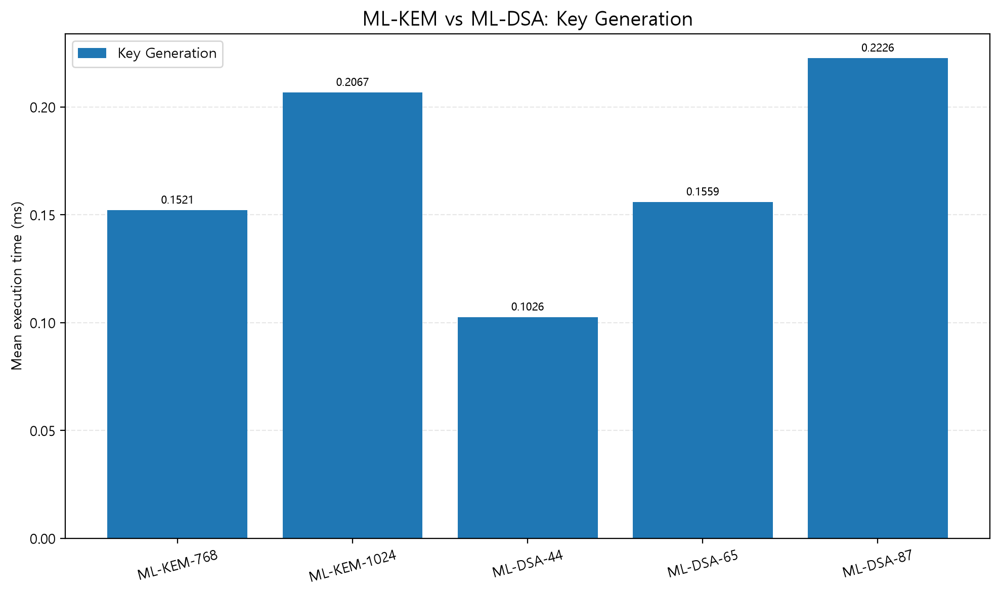
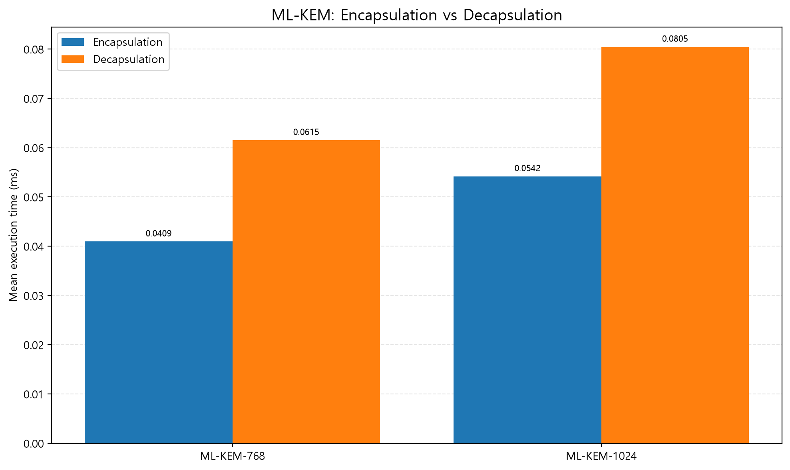
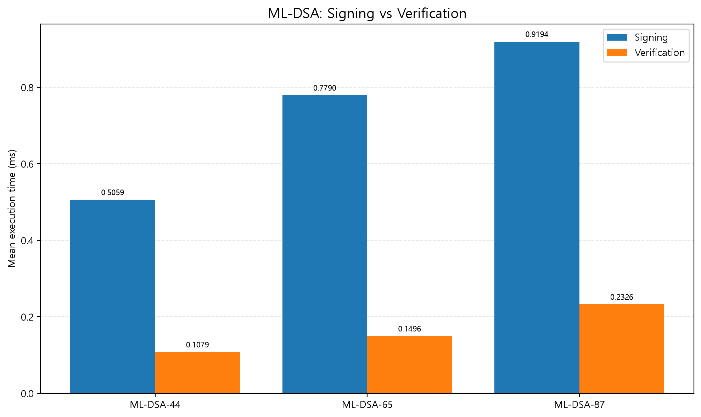
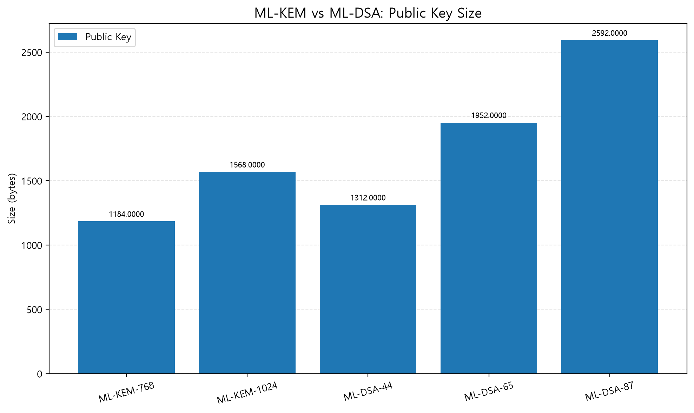
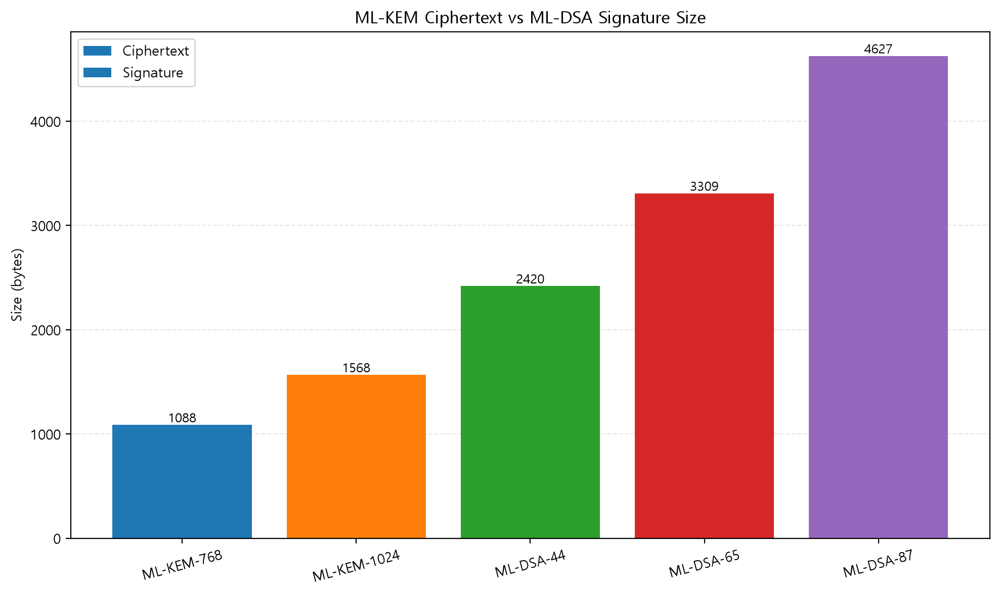

# PQC-benchmark

Python 기반으로 양자내성암호(Post-Quantum Cryptography, PQC) 알고리즘인 **ML-KEM과 ML-DSA의 실행 시간 및 데이터 크기를 측정하고 비교하는 프로젝트**입니다.

키 생성, 캡슐화, 디캡슐화, 전자서명, 서명 검증 연산을 반복 측정하고, 평균·중앙값 및 공개키·암호문·서명 크기를 분석합니다. 측정 결과는 CSV 파일로 저장하고 그래프로 시각화합니다.

## 목차

- [프로젝트 목적](#프로젝트-목적)
- [사용 기술](#사용-기술)
- [실험 대상](#실험-대상)
- [실험 환경](#실험-환경)
- [설치 및 실행 방법](#설치-및-실행-방법)
- [실험 결과](#실험-결과)
- [프로젝트 구조](#프로젝트-구조)
- [실험의 한계](#실험의-한계)

## 프로젝트 목적

양자내성암호 표준 알고리즘의 주요 연산을 직접 실행하고, 매개변수 집합에 따른 성능과 데이터 크기의 차이를 실험적으로 비교하는 것을 목표로 합니다.

주요 분석 항목은 다음과 같습니다.

- 연산별 평균 실행 시간 및 중앙값
- 공개키, 암호문 및 전자서명 크기
- ML-KEM 매개변수 집합에 따른 키 설정 성능 차이
- ML-DSA 매개변수 집합에 따른 서명 및 검증 성능 차이
- 실행 환경과 구현에 따른 벤치마크 결과 해석

## 사용 기술

- **Language:** Python
- **Cryptographic library:** `cryptography`
- **Data analysis:** pandas
- **Visualization:** Matplotlib
- **Data format:** CSV

## 실험 대상

### ML-KEM

ML-KEM(Module-Lattice-Based Key-Encapsulation Mechanism)은 통신 당사자 간 공유 비밀값을 설정하기 위한 키 캡슐화 메커니즘입니다.

측정 항목:

- Key Generation
- Encapsulation
- Decapsulation
- Public Key Size
- Ciphertext Size
- Shared Secret Size

현재 실험에서는 ML-KEM-768과 ML-KEM-1024를 비교합니다.

### ML-DSA

ML-DSA(Module-Lattice-Based Digital Signature Algorithm)는 메시지의 출처 인증과 무결성 확인을 위한 전자서명 알고리즘입니다.

측정 항목:

- Key Generation
- Signing
- Verification
- Public Key Size
- Signature Size

실험 코드는 ML-DSA-44, ML-DSA-65, ML-DSA-87을 대상으로 합니다.

## 실험 환경

| 항목 | 환경 |
|---|---|
| Operating System | Microsoft Windows 11 Pro |
| CPU | AMD Ryzen 5 5600X 6-Core Processor |
| Python | 3.14.5 |
| cryptography | 48.0.0 |
| Data analysis | pandas |
| Visualization | Matplotlib |

실행 시간은 위 환경에서 측정한 결과이며, 다른 하드웨어·운영체제·라이브러리 버전에서는 결과가 달라질 수 있습니다.

## 설치 및 실행 방법

### 1. 저장소 복제

```bash
git clone https://github.com/c7yb2ru/PQC-benchmark.git
cd PQC-benchmark
```

### 2. 가상환경 생성

Python 3.14.5 환경을 기준으로 작성했습니다.

Windows PowerShell:

```powershell
py -3.14 -m venv .venv
.\.venv\Scripts\Activate.ps1
```

가상환경 활성화가 제한되는 경우에는 PowerShell 실행 정책을 무리하게 변경하기 전에 다음 명령으로 가상환경의 Python을 직접 사용할 수 있습니다.

```powershell
.\.venv\Scripts\python.exe -m pip install --upgrade pip
```

### 3. 의존성 설치

```powershell
python -m pip install -r requirements.txt
```

### 4. ML-KEM 벤치마크 실행

```powershell
python test_mlkem.py
```

실행 결과는 `benchmark_results.csv`에 저장됩니다.

### 5. ML-DSA 벤치마크 실행

```powershell
python test_mldsa.py
```

실행 결과는 `mldsa_benchmark_results.csv`에 저장됩니다.

### 6. 비교 그래프 생성

두 벤치마크 CSV 파일이 생성된 후 다음 명령을 실행합니다.

```powershell
python plot_comparison.py
```

생성되는 그래프:

- `01_key_generation.png`
- `02_mlkem_operations.png`
- `03_mldsa_operations.png`
- `04_public_key_size.png`
- `05_ciphertext_signature_size.png`

그래프 파일은 저장소 루트 디렉터리에 저장됩니다.

## 실험 결과

### 1. 키 생성 시간



### 2. ML-KEM 캡슐화 및 디캡슐화



### 3. ML-DSA 서명 및 검증



### 4. 공개키 크기 비교



### 5. ML-KEM 암호문 및 ML-DSA 서명 크기



### ML-KEM 측정 결과

| 항목 | ML-KEM-768 | ML-KEM-1024 |
|---|---:|---:|
| 공개키 | 1,184 bytes | 1,568 bytes |
| 암호문 | 1,088 bytes | 1,568 bytes |
| 공유 비밀값 | 32 bytes | 32 bytes |
| 키 생성 평균 | 0.152130 ms | 0.206709 ms |
| 캡슐화 평균 | 0.040947 ms | 0.054187 ms |
| 디캡슐화 평균 | 0.061539 ms | 0.080471 ms |

위 실행 시간은 본 프로젝트의 측정 환경에서 얻은 평균값입니다.

ML-KEM-1024는 ML-KEM-768보다 키 생성 평균 시간이 약 35.9%, 캡슐화가 약 32.3%, 디캡슐화가 약 30.8% 길게 측정되었습니다. 또한 ML-KEM-1024는 공개키와 암호문 크기가 더 컸습니다.

이 결과는 해당 환경에서 관측된 성능 차이이며, 모든 구현 및 하드웨어 환경에서 동일한 차이가 발생한다고 의미하지는 않습니다.

ML-DSA의 상세 측정값은 `mldsa_benchmark_results.csv`에서 확인할 수 있습니다.

## 프로젝트 구조

```text
PQC-benchmark/
├── test_mlkem.py
├── test_mldsa.py
├── plot_comparison.py
├── benchmark_results.csv
├── mldsa_benchmark_results.csv
├── 01_key_generation.png
├── 02_mlkem_operations.png
├── 03_mldsa_operations.png
├── 04_public_key_size.png
├── 05_ciphertext_signature_size.png
├── requirements.txt
└── README.md
```

## 실험의 한계

- 측정 결과는 특정 하드웨어, Python 및 암호화 라이브러리 환경에 종속됩니다.
- 실행 시간과 데이터 크기만으로 알고리즘의 암호학적 안전성을 증명할 수 없습니다.
- ML-KEM과 ML-DSA는 서로 다른 기능을 제공하므로 연산 시간을 단순 비교해 우열을 판단할 수 없습니다.
- 실제 통신 시스템의 성능을 평가하려면 네트워크 지연, 데이터 전송량, 메모리 사용량 및 프로토콜 오버헤드 등을 추가로 측정해야 합니다.
- 현재 환경에서 지원되는 API를 기준으로 ML-KEM-768과 ML-KEM-1024를 측정하며, ML-KEM-512는 이번 실험에 포함하지 않았습니다.

## 향후 개선 방향

- 다양한 하드웨어 환경에서 반복 측정
- 실행 시간의 표준편차 및 변동성 분석
- 메모리 사용량과 통신 오버헤드 측정
- 실험 결과의 재현성 향상
- 실제 통신 환경을 고려한 양자내성암호 적용성 분석
